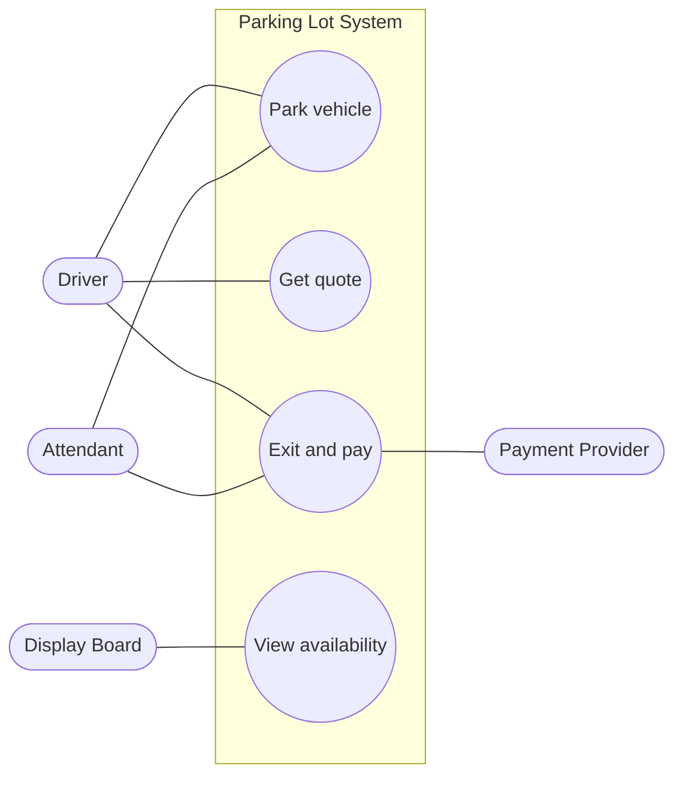
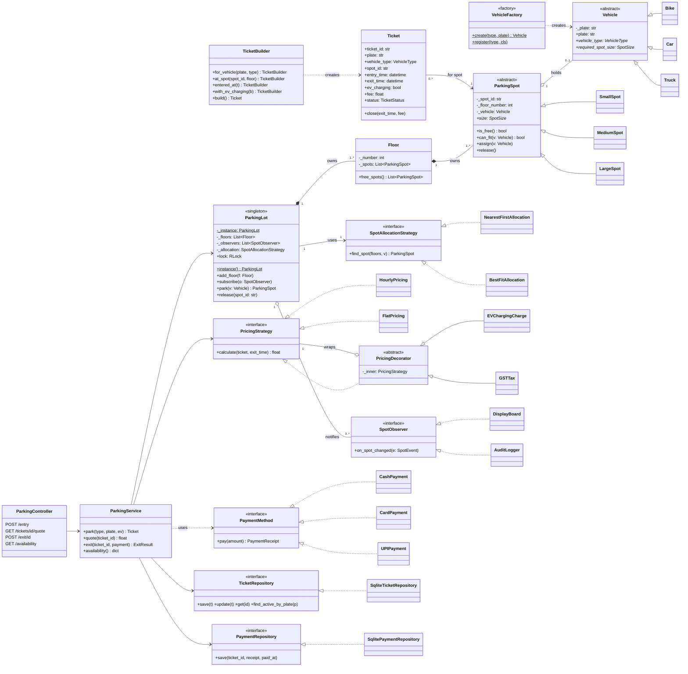
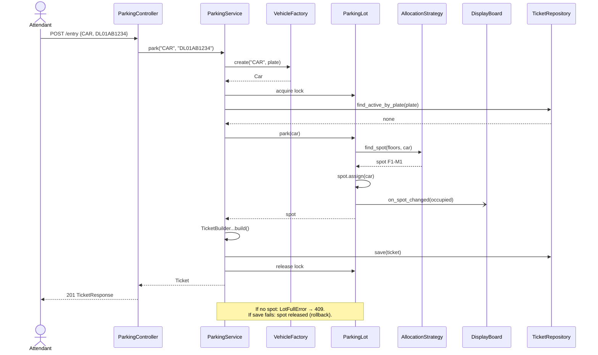
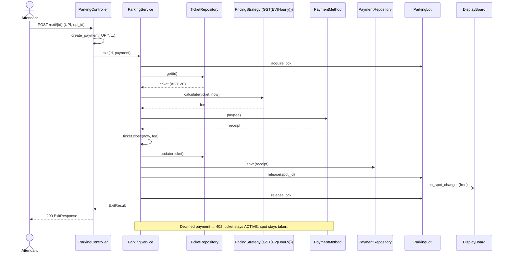
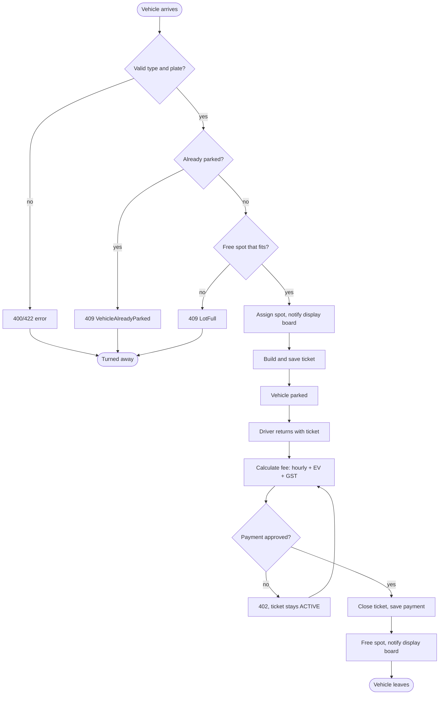
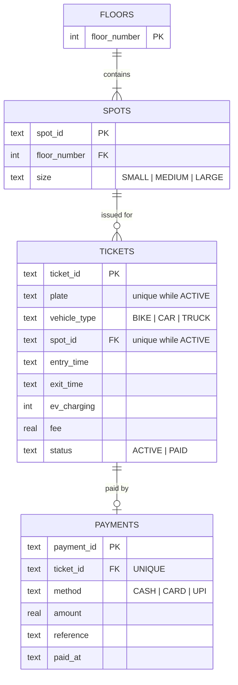

# Diagrams

All diagrams are Mermaid. They render on GitHub, or paste them into https://mermaid.live to export PNGs.

## 1. Use case diagram

## 2. Class diagram

**Relationships:** composition (lot owns floors, floor owns spots), aggregation (spot holds a vehicle that exists on its own; a decorator wraps a strategy), association (ticket → spot, service → repositories), inheritance/realisation (vehicle, spot, strategy, observer, payment hierarchies), dependency (builder/factory create objects).

## 3. Sequence diagram: vehicle entry (UC1)

## 4. Sequence diagram: exit and pay (UC3)

## 5. Activity diagram: full visit

## 6. ER diagram (database schema)

**Indexes:** `ux_active_ticket_per_spot` and `ux_active_ticket_per_plate` (partial unique indexes on `status = 'ACTIVE'`) stop double allocation even if application code had a bug; `ix_tickets_status` speeds up loading active tickets on restart.
